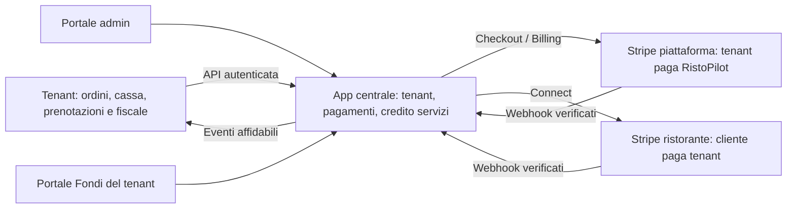

# Proposta: piattaforma centrale pagamenti e credito servizi

Stato: proposta architetturale, 17 novembre 2026. Nessuna integrazione Stripe è stata attivata da questo documento. L'app tenant mantiene la cassa e il modulo fiscale sandbox già implementati.

## Situazione rilevata

Il tenant contiene il motore ordini/cassa, quote e incassi misti, documenti fiscali sandbox per incasso, fatture italiane ordinarie, copie email, rimborsi gestionali e report. Non contiene una connessione Stripe attiva nel flusso corrente ordini. Rimangono riferimenti legacy in `ContactService`, `ContactController`, configurazione abbonamenti e job commentati.

È già presente un'app sorella `../ristomaster-admin`, con `TenantFundsService`, `FundsPaymentService`, job di ricarica, controller Stripe/webhook, onboarding Connect e controller checkout asporto/gift card. La presenza del codice non ne dimostra il funzionamento con l'attuale tenant. Nella ricognizione sono emersi importi monetari gestiti come float e aggiornamenti del saldo senza lock esplicito nei metodi letti: prima del riutilizzo servono verifica di autorizzazioni, concorrenza, idempotenza, mapping tenant e collaudo sandbox. Non sono stati modificati file dell'app sorella.

## Due rapporti economici

| Flusso | Venditore / creditore | Stripe | Dove si registra il saldo |
|---|---|---|---|
| Cliente acquista pasto, paga un ordine o versa un acconto al ristorante | Ristorante | Account collegato Connect; proposta iniziale direct charges | Incassi del ristorante e relativo saldo Stripe |
| Tenant paga abbonamento o acquista credito per servizi SaaS | RistoPilot | Account Stripe della piattaforma, Customer del tenant, Billing/Checkout | Registro centrale del credito servizi |

Un tenant ha due riferimenti distinti: account collegato che riceve i suoi incassi e Customer che paga RistoPilot. I Customer Stripe dei commensali sono a loro volta associati al contesto dell'account che li gestisce. Il Customer usato per fatturare il SaaS al tenant non è l'account Connect del ristorante.

Connect è pertinente quando RistoPilot abilita gli esercenti a ricevere pagamenti. Non è necessario per vendere esclusivamente l'abbonamento SaaS. Direct charges è il punto di partenza consigliato per questo modello: il ristorante resta il venditore del pasto. La configurazione di onboarding, commissioni, responsabilità per saldi negativi e contestazioni va scelta esplicitamente prima di implementare i flussi; il solo nome “Connect” non la determina.

Un eventuale fisso per ordine può essere addebitato come consumo contrattuale del credito servizi, anche per ordini saldati in contanti. Un'application fee Connect è un'alternativa per le transazioni Stripe. La stessa commissione non deve essere addebitata automaticamente in entrambi i modi.

## App e responsabilità

Una sola app centrale modulare, con due interfacce eventualmente su host differenti:

- `admin.…`: amministrazione piattaforma, tenant, tariffe, contratti, supporto, consumi e audit, accessibile allo staff autorizzato RistoPilot.
- `payments.…`: portale del tenant per saldo, movimenti, ricariche, metodi salvati, ricarica automatica, abbonamenti e onboarding Connect, accessibile ai ruoli finanziari del tenant.

I nomi degli host sono indicativi. Due host non richiedono due implementazioni indipendenti di saldo, webhook e pagamenti. Conviene valutare il recupero dell'app centrale esistente prima di creare un ulteriore progetto.

Il tenant resta autorevole su listini, disponibilità, prenotazioni, prodotti, sconti, quote, ordini e fiscalizzazione. L'app centrale è autorevole su intenti di pagamento, conferme Stripe, rimborsi PSP, registri del credito servizi e abbonamenti. Condivide con il tenant identificativi e stati, senza accedere direttamente ai database operativi di ogni ristorante.

## Accesso e sincronizzazione

Il link **Fondi** nel menu del tenant avvia un accesso SSO con codice breve, monouso, riscattato dall'app centrale tramite canale autenticato. Il centro verifica utente, tenant, ruolo e destinazione ammessa, quindi crea la propria sessione. Nessun login basato sul solo `tenant_id` passato nella URL e nessuna condivisione indiscriminata dei cookie fra domini. Per produzione usare HTTPS.

Ogni tenant ha un UUID globale e una credenziale server dedicata, revocabile e con scope. I riferimenti Stripe e il dominio di callback vengono ricavati dal registro centrale, non da parametri arbitrari del browser. Gli eventi hanno UUID, versione, origine e numero di sequenza; outbox/inbox e chiavi univoche permettono retry e recupero dei messaggi duplicati o fuori ordine.

Replicare soltanto i dati necessari: anagrafica aziendale, riferimenti contrattuali, stato dell'account e configurazione pagamenti. Per i clienti mantenere associazioni `(tenant_id, customer_id_locale)` e azioni pertinenti al servizio. Un'eventuale identità cliente globale richiede un progetto esplicito di identità, finalità, informative e accessi: un'email uguale non autorizza a fondere gli archivi o a condividere lo storico fra ristoranti. L'admin centrale deve limitare dati e visibilità al ruolo operativo necessario, con audit e regole di conservazione.

## Credito servizi e ricariche

Il portale può offrire tagli 10/20/30/50/100 euro e importo personalizzato entro limiti configurati; va deciso se il taglio indica il credito spendibile o il totale pagato, includendo il trattamento fiscale concordato per il servizio. I limiti vengono verificati lato server.

- Stripe incassa la ricarica. Il registro centrale determina il credito spendibile.
- I versamenti si contabilizzano soltanto dopo un pagamento verificato, con chiave univoca del pagamento. Il ritorno del browser non accredita il saldo.
- Movimenti immutabili per ricariche, consumi, prenotazioni di credito, rilasci e rettifiche. Saldo disponibile separato da credito impegnato e movimenti in attesa.
- Euro in centesimi per l'incasso; micro-euro interi per i servizi con tariffe inferiori al centesimo. Evitare float e arrotondamenti ripetuti.
- Tariffe versionate: quantità, servizio, prezzo applicato, evento originario e identificativo del documento/messaggio/ordine. Il costo del provider è separato dal prezzo venduto al tenant.
- Prenotazione del credito prima di un servizio a pagamento, addebito secondo l'esito previsto dal contratto, rilascio solo quando appropriato. Un timeout non equivale automaticamente a un servizio mai eseguito.
- Lock e vincoli idempotenti per evitare doppi addebiti e consumi concorrenti dello stesso credito.

Il credito servizi RistoPilot è separato da disponibilità del ristorante, caparre dei prenotanti e Gift Card. La proposta è destinarlo ai servizi offerti da RistoPilot; eventuali usi trasferibili o pagamenti verso terzi richiedono una valutazione differente.

Stripe Billing è adatto agli abbonamenti; i Billing Credits sono un'opzione da valutare per servizi misurati e fatturati con Billing, non un sostituto automatico del controllo credito in tempo reale. Non vanno confusi con un wallet universale o Gift Card.

La carta del tenant si raccoglie con Checkout/SetupIntent, senza salvare PAN/CVC in RistoPilot. L'autorizzazione deve distinguere abbonamento e ricariche automatiche, con importo, soglia, frequenza/limiti e revoca. Un solo tentativo di ricarica in corso per tenant; plafond e limiti periodici, gestione SCA, carta rifiutata e richiesta di intervento. L'esito off-session non è garantito.

Per la continuità operativa: avvisi prima dell'esaurimento e, se contrattualizzato, credito di emergenza limitato e tracciato. Evitare che un problema momentaneo del wallet cancelli incassi già acquisiti o faccia perdere un documento fiscale da emettere; sospendere nuove attività opzionali onerose secondo una policy distinta dai servizi critici. Anche il credito del provider esterno può esaurirsi e va monitorato separatamente. Il documento Billing/receipt Stripe non sostituisce automaticamente gli adempimenti fiscali italiani di RistoPilot verso il tenant.

## Flussi clienti del ristorante

| Caso | Interfaccia proposta | Integrazione nel tenant |
|---|---|---|
| Asporto/consegna online | Checkout ospitato per ordine | Ordine in attesa; conferma verificata e una sola registrazione dell'incasso |
| Pagamento al tavolo | QR che apre conto/quota e Checkout | Importo congelato, accesso limitato al conto, prevenzione doppio pagamento della quota |
| Pagamento remoto dalla cassa | Sessione Checkout univoca presentata come QR o link | Cassa mostra attesa/esito senza conferma manuale “già pagato” |
| Carta presente alla cassa | Stripe Terminal, lettore compatibile o Tap to Pay ove supportato | Importo inviato al dispositivo e conferma riportata automaticamente |
| Rimborsi | Richiesta PSP centrale e relativo esito | Rimborso finanziario e rettifica fiscale restano operazioni collegate ma distinte |
| Gift Card | Checkout per acquisto del buono | Emissione solo dopo pagamento, registro saldo, riscatti parziali e rettifiche |

Per il QR/link di un ordine usare sessioni univoche legate a ordine, quota, importo e versione del prezzo. Una riapertura del link non crea un secondo incasso. Terminal necessita di hardware/software compatibile: un POS bancario generico non diventa integrabile semplicemente collegandolo alla rete. QR/link può essere la prima versione; il terminale offre una modalità più diretta per clienti fisicamente presenti.

Il tenant deve ancora introdurre uno stato di pagamento in attesa, le riserve su quote/importi e il consumatore degli eventi centrali. Gestire scadenza, annullamento, modifica ordine, pagamento arrivato tardi o dopo un incasso manuale, disconnessione, rimborso parziale e contestazione. Un pagamento realmente acquisito va sempre registrato o segnalato per riconciliazione, anche se l'ordine è stato annullato. Non registrare contemporaneamente un incasso manuale e un incasso Stripe dello stesso denaro.

La ricezione del webhook precede la registrazione affidabile dell'incasso; il documento fiscale segue le regole applicabili al tipo di operazione. Il callback del browser da solo non dimostra il pagamento. Acconti, saldo, uso di un buono e garanzie non possono essere tutti convertiti automaticamente nella stessa vendita fiscale del totale ordine. La produzione E-Receipts resta un prerequisito separato dalla capacità di Stripe di incassare denaro.

## Prenotazioni, eventi e no-show

Il tenant deve decidere e congelare la policy al momento della prenotazione: importo fisso o a persona, soglia coperti, date/turni, form, evento, anticipo minimo, scadenza pagamento, termini di cancellazione, priorità fra regole sovrapposte ed eventuali esenzioni. Le modifiche al numero persone/data richiedono una regola esplicita di ricalcolo; le prenotazioni esistenti non cambiano retroattivamente policy.

Distinguere tre strumenti:

1. **Acconto incassato subito**: denaro già acquisito dal ristorante, con eventuale scomputo al saldo o rimborso secondo le condizioni applicabili.
2. **Carta salvata a garanzia**: SetupIntent e consenso specifico per una penale successiva. Nessuna riserva di fondi; l'addebito successivo può fallire o richiedere autenticazione.
3. **Preautorizzazione con cattura differita**: fondi riservati fino alla scadenza effettiva `capture_before`. Le finestre ordinarie sono di pochi giorni e dipendono da circuito/tipo di transazione; eventuali autorizzazioni estese hanno requisiti specifici. Non è una garanzia aperta per prenotazioni a mesi di distanza.

Un no-show può attivare una richiesta di addebito secondo la policy accettata, con operatore, motivo e prova dei termini. Stripe esegue il tentativo, non certifica da solo la fondatezza della penale. Acconto, caparra confirmatoria e penale non sono sinonimi e richiedono classificazione contrattuale/fiscale. Gift Card e credito servizi hanno a loro volta registri e trattamento dedicati; chiarire buono monouso/multiuso prima della fiscalizzazione.

## Sequenza di lavoro proposta

1. Ricognizione completa e test sandbox dell'app admin esistente; definizione del modello Connect e delle responsabilità; contratto API, identificativi globali e SSO.
2. Registro centrale credito servizi, ricariche manuali, webhook/inbox, portale Fondi e pubblicazione affidabile dei consumi dal tenant. Collaudo di concorrenza e duplicati.
3. Carta salvata, abbonamenti e ricariche automatiche con mandati distinti, limiti e gestione errori.
4. Onboarding Connect e pagamenti ordini online/QR, rimborsi e riconciliazione; collegamento al motore cassa/fiscale del tenant.
5. Regole garanzie prenotazioni/eventi, gestione no-show e acconti.
6. Gift Card e, quando scelto il dispositivo, integrazione Terminal.

I blocchi 2–3 (tenant paga RistoPilot) e 4–6 (cliente paga ristorante) condividono infrastruttura ma mantengono contabilità, autorizzazioni e riferimenti Stripe distinti.

## Fonti tecniche verificate

- [Stripe: piattaforma SaaS e quando usare Connect](https://docs.stripe.com/connect/saas)
- [Stripe: direct charges](https://docs.stripe.com/connect/direct-charges.md?platform=web&ui=stripe-hosted)
- [Stripe: salvare un metodo e riutilizzarlo](https://docs.stripe.com/payments/save-and-reuse)
- [Stripe: autorizzazione e scadenza della cattura](https://docs.stripe.com/payments/place-a-hold-on-a-payment-method)
- [Stripe: abbonamenti](https://docs.stripe.com/billing/subscriptions/overview)
- [Stripe: Billing Credits, usi e limiti](https://docs.stripe.com/billing/subscriptions/usage-based/billing-credits)
- [Stripe: checkout, webhook e fulfillment idempotente](https://docs.stripe.com/checkout/fulfillment.md?ui=full-page)
- [Stripe: integrazione Terminal](https://docs.stripe.com/terminal/payments/setup-integration)
- [MEF: buoni multiuso, art. 6-quater DPR 633/1972](https://def.finanze.it/DocTribFrontend/getAttoNormativoDetail.do?ACTION=getArticolo&codiceOrdinamento=0000000000000069999900004000000000000000000000000000000000000000000000000000000000000000000000000000000000000000000000000000000000&id=%7B75A4827C-3766-4ECC-9C45-00C8D6CDC552%7D)
